# Smart Parking Lot Backend System (Low-Level Design & Implementation)

An industrial-grade, concurrent backend system for managing multi-floor, multi-spot urban parking lots. Designed strictly adhering to the requirements of the project brief, **SOLID** principles, Clean Architecture, and enterprise concurrency safeguards.

---

## 📈 Code Coverage

The test suite achieves **>95% overall code coverage** verified via the JaCoCo engine across all domain, service, strategy, entity, and controller layers:

| Metric | Covered | Total | Coverage % |
| :--- | :--- | :--- | :--- |
| **Line Coverage** | **708** | **741** | **95.55%** |
| **Instruction Coverage** | **3,124** | **3,265** | **95.68%** |
| **Branch Coverage** | **163** | **201** | **81.09%** |

### Package-Level Coverage Breakdown
| Package | Line Coverage | Instruction Coverage |
| :--- | :--- | :--- |
| `com.smartparking.service` | **98.24%** | 97.46% |
| `com.smartparking.model.domain` | **97.14%** | 96.60% |
| `com.smartparking.strategy.fee` | **98.15%** | 96.53% |
| `com.smartparking.model.entity` | **91.90%** | 93.42% |
| `com.smartparking.strategy.allocation` | **85.00%** | 90.72% |
| `com.smartparking.controller` | **93.94%** | 88.24% |
| `com.smartparking.exception` | **100.00%** | 97.24% |
| `com.smartparking.dto` | **100.00%** | 100.00% |
| `com.smartparking.enums` | **100.00%** | 100.00% |
| `com.smartparking.event` | **100.00%** | 100.00% |

To view the full visual HTML coverage report, open `target/site/jacoco/index.html` after running `mvn test`.

---

## 🚀 Core Features (Mapped to Requirements)

* **Intelligent Spot Allocation**: Automatically assigns the nearest available spot based on vehicle dimensions (`Motorcycle`, `Car`, `Bus`) and proximity to entry gates.
* **Pluggable Allocation & Fee Strategies**:
  - Allocation: `NearestSpotAllocationStrategy` (proximity-based) & `BestFitAllocationStrategy` (strictly minimizes capacity waste).
  - Pricing: `TieredDurationFeeStrategy` (grace period, tiered hourly rates, vehicle multiplier) & `FlatFeeStrategy`.
* **Vehicle Check-In & Check-Out**:
  - Issues tickets upon arrival with zero orphan records.
  - Generates itemized invoices upon departure.
  - Idempotent ticket cancellation that releases spots and prevents repeat mutations.
* **Real-Time Availability Observer**: High-performance $O(1)$ in-memory cached counters updated immediately via event listeners upon every spot transition.
* **Dual-Layer Concurrency Defense**: Fine-grained in-memory spot locking (`ReentrantLock`) combined with JPA Optimistic Concurrency Control (`@Version`), guaranteeing **zero double-allocations** across concurrent multi-gate entries.

---

## 🏛️ Architecture & Design Patterns

```
                                  [ Client / IoT Gate / REST ]
                                                 │
                                                 ▼
                                     [ ParkingLotController ]
                                                 │
                                                 ▼
                                       [ ParkingLotService ]
                       ┌─────────────────────────┼─────────────────────────┐
                       ▼                         ▼                         ▼
            [ SpotAllocationEngine ]   [ FeeCalculationEngine ]   [ AvailabilityService ]
              (Strategy Pattern)         (Strategy Pattern)          (Observer Pattern)
                       │                         │                         │
                       └─────────────────────────┼─────────────────────────┘
                                                 │
                                                 ▼
                                        [ In-Memory H2 DB ]
```

### Design Patterns Used:
| Pattern | Implementation | Purpose |
| :--- | :--- | :--- |
| **Strategy Pattern** | `SpotAllocationStrategy`, `FeeCalculationStrategy` | Pluggable spot allocation (`Nearest`, `Best-Fit`) and pricing calculation (`Tiered`, `Flat`). |
| **Factory Pattern** | `VehicleFactory` | Encapsulates polymorphic vehicle instantiation (`Motorcycle`, `Car`, `Bus`). |
| **Observer Pattern** | `SpotStatusChangedEvent`, `AvailabilityService` | Decouples spot state transitions from live floor display boards and capacity monitors. |
| **Facade Pattern** | `ParkingLotService` | Provides unified, transactional high-level operations for check-in, check-out, and cancellation. |
| **Optimistic Lock** | `ParkingSpotEntity.@Version` | Database-level concurrency guard preventing lost updates and race conditions. |

---

## 📊 Domain & Data Model

### Entity-Relationship Diagram (ERD)

```mermaid
erDiagram
    PARKING_LOT ||--o{ PARKING_FLOOR : contains
    PARKING_FLOOR ||--o{ PARKING_SPOT : contains
    PARKING_SPOT ||--o{ PARKING_TICKET : assigned_to
    PARKING_TICKET ||--o| INVOICE : generates

    PARKING_LOT {
        string id PK
        string name
        string address
        int totalFloors
    }

    PARKING_FLOOR {
        string id PK
        string lotId FK
        int floorNumber
        int totalSpots
    }

    PARKING_SPOT {
        string id PK
        int floorNumber
        int spotNumber
        string spotType
        string status
        int distanceMetric
        string currentVehiclePlate
        long version
    }

    PARKING_TICKET {
        string id PK
        string licensePlate
        string vehicleType
        string spotId FK
        int floorNumber
        string entryGateId
        timestamp entryTime
        timestamp exitTime
        string status
    }

    INVOICE {
        string id PK
        string ticketId FK
        string licensePlate
        string vehicleType
        string spotId
        string exitGateId
        timestamp entryTime
        timestamp exitTime
        long durationMinutes
        decimal baseFee
        decimal hourlyFee
        decimal vehicleMultiplier
        decimal totalAmount
        string paymentStatus
    }
```



---

## 💵 Fee Calculation Engine

Fees are computed dynamically using `TieredDurationFeeStrategy`:
* **Grace Period**: First **15 minutes** are free ($0.00).
* **Hour 1 (Base Fee)**: Flat **$4.00**.
* **Hours 2 to 4 (Tier 1)**: **$3.50 / hour**.
* **Hours 5+ (Tier 2)**: **$2.50 / hour**.
* **Vehicle Multipliers**:
  - `MOTORCYCLE`: **0.6x**
  - `CAR`: **1.0x**
  - `BUS`: **2.5x**

*Example*: A Car parked for 2 hours 15 minutes is billed for 3 hours:
$$\text{Total} = (\$4.00 + 2 \times \$3.50) \times 1.0 = \$11.00$$

---

## 🔍 How to Check the Working

### Method 1: Automated Unit & Concurrency Test Suite
Run the 40 tests covering all functional and non-functional requirements:
```bash
mvn clean test
```
**Test Coverage Highlights**:
* `ParkingLotConcurrencyTest`: Simulates **50 concurrent threads** racing to book parking spots simultaneously. Verifies zero double-allocations, exact capacity enforcement (22 cars succeed, 28 rejected), and concurrent checkout restoration.
* `ParkingLotServiceIntegrationTest`: End-to-end check-in, real-time availability decrement, check-out with fee calculation, availability restoration, duplicate check-in prevention, and ticket cancellation lifecycle.
* `EdgeCasesAndExceptionHandlingTest`: Defensive null/blank argument validations, grace period thresholds (0 min, 15 min, 16 min, 60 min, 61 min, 24-hr stays), re-entry after checkout, spot incompatibility, and REST API malformed input handling.
* `NearestSpotAllocationStrategyTest` & `BestFitAllocationStrategyTest`: Proximity ordering, vehicle size compatibility, and capacity optimization.
* `TieredDurationFeeStrategyTest` & `FlatFeeStrategyTest`: Grace period ($\le 15$ min free), 1st hour flat rate, tiered hourly rates, and vehicle multipliers ($0.6\times$ Motorcycle, $1.0\times$ Car, $2.5\times$ Bus).
* `ParkingLotControllerTest`: REST API endpoints for entry, exit, cancel, availability, and strategy switching.

---

### Method 2: REST API & cURL Commands
Start the backend server:
```bash
mvn spring-boot:run
```
The server starts on port `8080`.

#### 1. Check Real-Time Availability
```bash
curl -X GET http://localhost:8080/api/v1/parking/availability
```

#### 2. Check-In (Park Vehicle)
```bash
curl -X POST http://localhost:8080/api/v1/parking/entry \
  -H "Content-Type: application/json" \
  -d '{
    "licensePlate": "KA-01-AB-1234",
    "vehicleType": "CAR",
    "entryGateId": "GATE-NORTH-1"
  }'
```

#### 3. Check-Out (Unpark & Pay)
```bash
curl -X POST http://localhost:8080/api/v1/parking/exit \
  -H "Content-Type: application/json" \
  -d '{
    "ticketId": "<PASTE_TICKET_ID>",
    "exitGateId": "GATE-SOUTH-1",
    "exitTime": "2026-10-23T12:30:00"
  }'
```

#### 4. Cancel Parking Ticket
```bash
curl -X POST http://localhost:8080/api/v1/parking/ticket/<PASTE_TICKET_ID>/cancel
```

#### 5. Switch Strategy at Runtime
```bash
# Switch allocation strategy to Best-Fit
curl -X POST "http://localhost:8080/api/v1/parking/strategy/allocation?strategy=bestfit"

# Switch fee calculation strategy to Flat rate
curl -X POST "http://localhost:8080/api/v1/parking/strategy/fee?strategy=flat"
```

#### 6. Database Inspection (H2 Console)
Navigate to `http://localhost:8080/h2-console` in your browser:
* **JDBC URL**: `jdbc:h2:mem:parkinglotdb`
* **Username**: `sa`
* **Password**: `[leave blank]`
